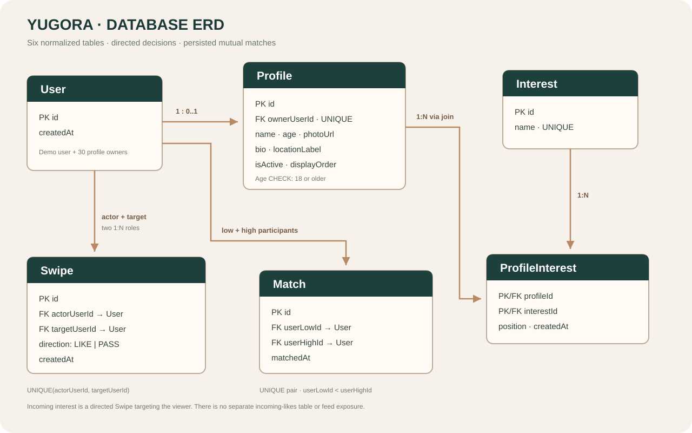

  

<h3 align="center">A connection, only when it is mutual.</h3>

A privacy-first discovery experience built around one product rule: one-sided interest stays private; only reciprocal interest becomes a match.

---

## Product scope

YUGORA is a standalone implementation of the Coy SDE Intern assignment. It has an editorial **Home** experience, passwordless email sign-in, an editable personal profile, a functional **Discover** experience and a **Matches** view containing confirmed mutual matches only.

The demo contains 30 fictional profiles and eight seeded incoming likes. Each person signs in with a one-time code sent to their email address. User identity is resolved on the server from the Neon Auth session; no user ID is accepted from the browser. It does not use Coy production code, user data or private services.

## Core behavior

- One profile at a time, with touch/pointer drag on mobile and Like/Pass controls on desktop.
- A decision is saved before its card leaves the deck. Failed requests preserve the active profile.
- A profile already swiped on is excluded for the current round. When the 30-profile round is exhausted, the user can start another round; only their `PASS` decisions are cleared. `LIKE` decisions and persisted matches remain intact.
- Profiles are created and edited by their owner. Hobbies can be picked from suggestions or entered as custom text; up to ten are stored per profile.
- A match requires two persisted, opposite-direction LIKE decisions.
- Incoming one-sided interest is never included in feed or match DTOs.
- Swipes and matches are stored in PostgreSQL and survive reloads.
- Match celebration is shown only after the server confirms a mutual match.

## Architecture

The domain owns the mutual-match rule. Application use cases coordinate the workflow through ports. Next.js route handlers are inbound adapters; Prisma/PostgreSQL repositories are outbound adapters.

| Layer | Responsibility |
|---|---|
| Domain | Profile, directed Swipe, canonical Match, matching policy |
| Application | Feed, swipe and match use cases; repository and Unit of Work ports |
| HTTP | Request validation, stable error mapping and private response headers |
| Persistence | Prisma 7 repositories, PostgreSQL migrations, transaction-scoped pair locks |
| Identity | Neon Auth managed Better Auth, first-party HttpOnly session proxy and server-resolved user IDs |
| Profile | Owner-scoped profile setup/editing and normalized, reusable custom interests |
| UI | Public landing page, Home vision, Discover card, gestures, profile editor, match celebration and Matches view |

### Matching data model

There is no separate incoming-like table. An incoming LIKE is a directed Swipe whose target is the demo user. The viewer's feed is filtered only by decisions authored by that viewer.

Important database protections include unique directed decisions, self-swipe and age constraints, canonical match-pair uniqueness, reciprocal-LIKE triggers, immutable swipe decisions and automatic removal of matches whose supporting swipe is deleted.

## HTTP API

| Method | Route | Purpose |
|---|---|---|
| `GET` | `/feed` | Eligible public profiles; excludes viewer-authored decisions |
| `POST` | `/swipe` | Persists `LIKE` or `PASS`; returns a confirmed match when mutual |
| `GET` | `/matches` | Returns persisted mutual matches only |
| `GET` / `PUT` | `/api/profile` | Loads or updates the signed-in user's profile |
| `POST` | `/api/feed/reset` | Starts a new round by clearing only this user's `PASS` decisions |
| `GET` / `POST` | `/api/auth/*` | First-party proxy for Neon Auth email OTP and session operations |

The swipe request accepts only `profileId` and `direction`. The acting user is resolved server-side.

See [API contracts](docs/api/contracts.md), [data model](docs/architecture/data-model.md), and the [architecture decisions](docs/architecture/decisions/).

## Run locally

**Requirements:** Node.js 22.12 or newer and PostgreSQL 16 or compatible PostgreSQL.

1. Install dependencies: `npm ci`.
2. Copy `.env.example` to `.env`.
3. Set `DATABASE_URL` to a pooled PostgreSQL URL (or a local direct URL for development).
4. Set `DATABASE_URL_UNPOOLED` to a direct, unpooled PostgreSQL URL for migrations. `DIRECT_URL` is supported as a legacy alias.
5. For local-only demo mode, set `YUGORA_TEST_IDENTITY=demo` and `DEMO_USER_ID=demo-user`. Never set `YUGORA_TEST_IDENTITY=demo` in a deployed environment.
6. To use real email sign-in locally, set `NEON_AUTH_BASE_URL` to the Auth URL for your Neon branch and add your local origin to its trusted origins.
7. For the deployed Preview, Neon Auth is provisioned on the same dedicated `yugora-demo-ready` Neon branch. The Vercel Preview variable `NEON_AUTH_BASE_URL` is scoped only to `feature/postgres-production-hardening`.
8. Run `npm run db:deploy`, then `npm run db:seed`.
9. Start the app with `npm run dev`.

The seed is idempotent and creates the 30 fictional profiles and eight incoming demo likes. Real users create their own `Profile` after email sign-in; the email address is stored by Neon Auth and is never part of public profile DTOs.

## Verification

- `npm run check` — schema validation, TypeScript, configuration, architecture, PostgreSQL persistence, HTTP integration and UI logic tests.
- `npm run test:e2e` — Chromium journeys against the production Next.js server.
- `npm run vercel-build` — deploy migrations, run the idempotent seed and build Next.js in deployment order.
- `npm audit --audit-level=high` — dependency audit.

The current workflow is [YUGORA quality gates](.github/workflows/architecture-check.yml). The [quality plan](docs/quality/architecture-test-plan.md) lists behavior and release checks.

## Protected Preview

The current candidate is deployed to a protected Vercel Preview:

- [Open the YUGORA Preview](https://yugora-git-feature-postgres-production-hardening-manjeet12.vercel.app/)
- Git branch: `feature/postgres-production-hardening`
- Revision: `177a47c37ef10a82245e75c8f4093310c94dcca2`
- Neon branch: `yugora-demo-ready` in Singapore (`aws-ap-southeast-1`)

Vercel environment variables are scoped to Preview and this Git branch only: sensitive pooled `DATABASE_URL` for runtime traffic, sensitive direct `DATABASE_URL_UNPOOLED` for Prisma migrations, and `DEMO_USER_ID` for the assignment demo identity. The database branch uses transaction pooling and explicit `sslmode=verify-full` for both URLs. The earlier `yugora-preview` branch is preserved separately with the prior interaction history.

Both PostgreSQL migrations have applied successfully. The idempotent seed created 30 Profile rows, 31 User rows (including the demo identity), eight incoming Swipe LIKE rows and zero Match rows. The Neon default branch remains separate and has no YUGORA application tables. The clean demo branch starts with zero demo-user decisions and zero matches.

Protected Preview smoke checks returned 200 from `GET /`, `GET /feed` (30 profiles) and `GET /matches` (zero matches). The Matches response has private/no-store caching; deployed responses include HSTS and baseline security headers. Hosted `POST /swipe` acceptance checks passed for idempotent retries, conflicting decisions, unknown profiles, client actor overrides, unsupported media type, malformed JSON and oversized bodies. The configured edge rate limit was exercised: 60 requests returned 200 and request 61 returned 429. A brand-new reciprocal-match creation and persistence across separate Function invocations remain to be verified on a fresh QA identity.

The Vercel project remains SSO-protected. No Production database variables have been configured and no Production deployment has been promoted. The Preview uses Neon Auth email OTP on the dedicated Neon branch, and application identity comes from the HttpOnly auth session. Neon recommends a dedicated SMTP provider for production email delivery; the branch's shared sender is suitable for development/Preview testing only.

See [security and release review](docs/SECURITY-REVIEW.md) for the remaining deployment gates.

## Assignment notes

Part A's two preliminary Coy feature recommendations and their evidence boundary are in [Part A recommendations](docs/PART-A-PRODUCT-RECOMMENDATIONS.md). The private Coy walkthrough still needs to be completed before those recommendations are presented as personally validated.

---

<strong>YUGORA</strong> <em>Two sides. One genuine connection.</em>

