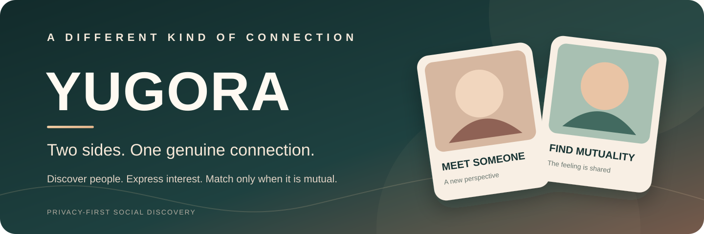

  

<h3 align="center">A connection, only when it is mutual.</h3>

A privacy-first discovery experience built around one product rule: one-sided interest stays private; only reciprocal interest becomes a match.

---

## Product scope

YUGORA is a standalone implementation of the Coy SDE Intern assignment. It has a deliberately blank **Home** tab, a functional **Discover** experience and a **Matches** view containing confirmed mutual matches only.

The demo contains 30 fictional profiles and eight seeded incoming likes. It assumes one server-configured demo user, as permitted by the assignment. It does not use Coy production code, user data or private services.

## Core behavior

- One profile at a time, with touch/pointer drag on mobile and Like/Pass controls on desktop.
- A decision is saved before its card leaves the deck. Failed requests preserve the active profile.
- A profile already swiped on is excluded from subsequent feeds.
- A match requires two persisted, opposite-direction LIKE decisions.
- Incoming one-sided interest is never included in feed or match DTOs.
- Swipes and matches are stored in PostgreSQL and survive reloads.
- Match celebration is shown only after the server confirms a mutual match.

## Architecture

The domain owns the mutual-match rule. Application use cases coordinate the workflow through ports. Next.js route handlers are inbound adapters; Prisma/PostgreSQL repositories are outbound adapters.

| Layer | Responsibility |
|---|---|
| Domain | Profile, directed Swipe, canonical Match, matching policy |
| Application | Feed, swipe and match use cases; repository and Unit of Work ports |
| HTTP | Request validation, stable error mapping and private response headers |
| Persistence | Prisma 7 repositories, PostgreSQL migrations, transaction-scoped pair locks |
| UI | Discover card, gestures, navigation, match celebration and Matches view |

### Matching data model

There is no separate incoming-like table. An incoming LIKE is a directed Swipe whose target is the demo user. The viewer's feed is filtered only by decisions authored by that viewer.

Important database protections include unique directed decisions, self-swipe and age constraints, canonical match-pair uniqueness, reciprocal-LIKE triggers, immutable swipe decisions and automatic removal of matches whose supporting swipe is deleted.

## HTTP API

| Method | Route | Purpose |
|---|---|---|
| `GET` | `/feed` | Eligible public profiles; excludes viewer-authored decisions |
| `POST` | `/swipe` | Persists `LIKE` or `PASS`; returns a confirmed match when mutual |
| `GET` | `/matches` | Returns persisted mutual matches only |

The swipe request accepts only `profileId` and `direction`. The acting user is resolved server-side.

See [API contracts](docs/api/contracts.md), [data model](docs/architecture/data-model.md), and the [architecture decisions](docs/architecture/decisions/).

## Run locally

**Requirements:** Node.js 22.12 or newer and PostgreSQL 16 or compatible PostgreSQL.

1. Install dependencies: `npm ci`.
2. Copy `.env.example` to `.env`.
3. Set `DATABASE_URL` to a pooled PostgreSQL URL (or a local direct URL for development).
4. Set `DATABASE_URL_UNPOOLED` to a direct, unpooled PostgreSQL URL for migrations. `DIRECT_URL` is supported as a legacy alias.
5. Keep `DEMO_USER_ID` set to the assignment demo identity unless you intentionally use a separate local fixture.
6. Run `npm run db:deploy`, then `npm run db:seed`.
7. Start the app with `npm run dev`.

The seed is idempotent and creates the 30 fictional profiles and eight incoming demo likes.

## Verification

- `npm run check` — schema validation, TypeScript, configuration, architecture, PostgreSQL persistence, HTTP integration and UI logic tests.
- `npm run test:e2e` — Chromium journeys against the production Next.js server.
- `npm run vercel-build` — deploy migrations, run the idempotent seed and build Next.js in deployment order.
- `npm audit --audit-level=high` — dependency audit.

The current workflow is [YUGORA quality gates](.github/workflows/architecture-check.yml). The [quality plan](docs/quality/architecture-test-plan.md) lists behavior and release checks.

## Deployment boundary

The assignment uses one shared demo identity; this is not a production multi-user authentication model. Keep interactive Preview deployments protected by Vercel SSO. Do not expose the mutable shared demo as an unrestricted public application.

The Vercel project and API rate-limit rule are configured. Neon connection and protected Preview acceptance remain outstanding. The production migration configuration requires a direct, unpooled database URL and will fail closed if one is missing in a deployed environment.

See [security and release review](docs/SECURITY-REVIEW.md) for the remaining deployment gates.

## Assignment notes

Part A's two preliminary Coy feature recommendations and their evidence boundary are in [Part A recommendations](docs/PART-A-PRODUCT-RECOMMENDATIONS.md). The private Coy walkthrough still needs to be completed before those recommendations are presented as personally validated.

---

<strong>YUGORA</strong> <em>Two sides. One genuine connection.</em>

