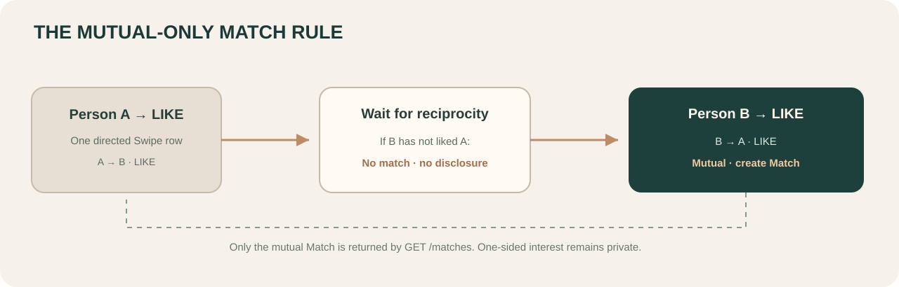
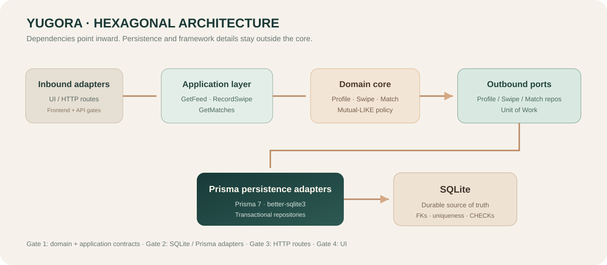

<div align="center">
  
  <br />
  <a href="https://github.com/Manjeet2684/Yugora/actions/workflows/architecture-check.yml"></a>
  
  
  
  
</div>

<h3 align="center">A connection, only when it's mutual.</h3>

<p align="center">
  YUGORA is a privacy-first, swipe-based social discovery application.<br />
  Interest can be expressed privately. A connection becomes visible only when both people choose it.
</p>

<p align="center">
  <a href="#product-principle">Product</a> ·
  <a href="#system-architecture">Architecture</a> ·
  <a href="#database-design">ER diagram</a> ·
  <a href="#getting-started">Run locally</a> ·
  <a href="#codebase-map">Codebase</a> ·
  <a href="COPYRIGHT.md">Copyright</a>
</p>

---

## Product principle

YUGORA is built around one rule: **a match is mutual or it is not a match.** One-sided interest is private and does not change feed eligibility.

| User action | What gets persisted | What the other person can see |
|---|---|---|
| A likes B | Directed `Swipe(A → B, LIKE)` | Nothing about A's one-sided interest |
| A passes B | Directed `Swipe(A → B, PASS)` | Nothing |
| B also likes A | A second directed LIKE and one canonical `Match(A, B)` | The confirmed mutual match |



### Assignment scope

This is a standalone implementation of the Coy SDE Intern assignment. **Home is intentionally blank**; Discover is the functional swipe experience, and Matches lists confirmed mutual connections. The assignment asks for 30+ mock profiles, pre-seeded incoming likes, swipe decisions that survive reloads, mutual-only matches, and these backend operations:

| Method | Route | Contract |
|---|---|---|
| `GET` | `/feed` | Profiles the current user has not swiped on |
| `POST` | `/swipe` | Persist `LIKE` or `PASS`; return whether a mutual match was created |
| `GET` | `/matches` | Return only persisted mutual matches |

> No Coy production code, user data, or private service is included. All seed profiles are fictional demo fixtures.

## Delivery roadmap

| Gate | Deliverable | Status |
|---|---|---|
| **1 · Architecture** | Domain entities, policies, use cases, ports, API contracts, ADRs, architecture tests |  |
| **2 · Persistence** | Prisma 7, PostgreSQL schema/migrations, repositories, transactional Unit of Work, 30 profiles, 8 incoming demo likes, mutual-match database triggers, real-database tests |  |
| **3 · Backend** | Root-path Next.js Route Handlers, strict JSON validation, safe error mapping, private/no-store responses, real-PostgreSQL HTTP integration tests |  |
| **4 · Frontend** | Mobile-first Discover, pointer/touch swipe gestures, desktop Like/Pass controls, server-confirmed match celebration, Matches view and responsive states |  |
| **5 · Quality** | Chromium browser journeys, keyboard/modal focus testing, responsive checks, failure recovery, baseline security headers and release-readiness review |  |

Gates 1–5 quality checks are implemented and CI-verified. Chromium browser journeys now exercise the production Next.js server with deterministic API fixtures plus an unmocked PostgreSQL-backed full-stack match/reload journey, alongside the real-PostgreSQL architecture, persistence and HTTP suites. **Public release is still gated**: the assignment intentionally uses one shared demo identity, and production authentication/identity, platform rate limiting, HTTPS deployment settings and operational monitoring have not been provisioned.


## Gate 4 — The YUGORA experience

The app opens directly into **Discover**. The Home tab is deliberately blank to match the assignment brief. Discover presents one profile at a time with image fallback, profile details, interests, responsive LIKE/PASS controls, touch/pointer drag, and keyboard arrow shortcuts. The Matches tab lists only records returned by `GET /matches`.

The client uses the same `POST /swipe` operation for drag gestures and desktop buttons. A card animates away only after the API confirms the decision; on request failure it stays visible and the user can retry. A match celebration is shown only after the server returns a confirmed Match DTO. Feed, swipe and matches failures each have explicit recovery states. The interface respects `prefers-reduced-motion` and exposes labelled controls and live status feedback.

The UI does not determine match eligibility, infer incoming interest, or keep swipe decisions as its source of truth. A reload fetches the authoritative feed and matches from PostgreSQL-backed APIs.


## Gate 5 — Browser QA and release boundary

The Playwright suite launches the built Next.js production server and drives real Chromium pages. For deterministic user journeys it intercepts the browser's same-origin API calls; real database and HTTP correctness remain covered separately by the PostgreSQL-backed integration suites. Browser coverage includes Pass, one-sided Like, server-confirmed mutual Match, reload/feed exclusion, empty feed, independent feed/swipe/matches failure recovery, broken-image fallback, keyboard shortcuts, native touchscreen drag in mobile emulation, dialog focus trapping and Escape dismissal, reduced motion, accessible button names, responsive overflow, and security headers.

The application now emits a baseline Content Security Policy and browser security headers. The policy allows the current Next.js inline runtime and the seeded profile image host, so it is a baseline rather than a strict nonce-based CSP. No HSTS header is sent before an HTTPS deployment exists. The API does not advertise CORS access to other origins; relative same-origin requests and JSON content-type validation are used by the client.

**Release blockers remain explicit:** `DEMO_USER_ID` represents a shared assignment demo account, not individual authentication; durable production rate limiting and abuse controls are not implemented; no hosting platform, domain, HTTPS certificate, secrets or monitoring target has been configured. Do not treat a successful CI/browser pass as a public-production deployment approval.


## Part A — Product recommendations

Two preliminary Coy feature recommendations and their privacy guardrails are recorded in [Part A product recommendations](docs/PART-A-PRODUCT-RECOMMENDATIONS.md). They are based on the public product description and Terms, not a claimed private-app walkthrough. The required OTP, add-crush, email-verification, invite-link and extra-slots walkthrough still needs applicant validation.

## System architecture



YUGORA follows **Hexagonal Architecture (Ports and Adapters)**. The domain owns the matching rule. The application layer coordinates use cases. Infrastructure implements outbound ports. Database, HTTP, and UI details do not become business logic.

<details>
  <summary><strong>Open the architecture diagram source (Mermaid)</strong></summary>

  ```mermaid
  flowchart LR
    UI[Discover & Matches UI<br/>Gate 4] --> HTTP[HTTP Route Handlers<br/>Gate 3]
    HTTP --> APP[Application Use Cases<br/>Gate 1]
    APP --> DOMAIN[Domain Entities & Policies<br/>Gate 1]
    APP --> PORTS[Outbound Repository Ports<br/>Gate 1]
    PORTS -. implemented by .-> ADAPTERS[Prisma Repositories<br/>Gate 2]
    ADAPTERS --> DB[(PostgreSQL)]
  ```
  Editable source: [`docs/diagrams/architecture.mmd`](docs/diagrams/architecture.mmd).
</details>

### Transaction boundary

`RecordSwipeUseCase` invokes `UnitOfWorkPort`. `PrismaUnitOfWork` provides one interactive Prisma transaction to the Profile, Swipe, and Match repositories. The outgoing decision, reciprocal LIKE lookup, and canonical Match insert commit or roll back together.

## Database design


<details>
  <summary><strong>Open the ER diagram source (Mermaid)</strong></summary>

  ```mermaid
  erDiagram
    USER ||--o| PROFILE : owns
    PROFILE ||--o{ PROFILE_INTEREST : has
    INTEREST ||--o{ PROFILE_INTEREST : labels
    USER ||--o{ SWIPE : actor
    USER ||--o{ SWIPE : target
    USER ||--o{ MATCH : low_participant
    USER ||--o{ MATCH : high_participant

    USER {
      string id PK
      datetime createdAt
    }
    PROFILE {
      string id PK
      string ownerUserId FK,UK
      string name
      int age
      string photoUrl
      string bio
      string locationLabel
      boolean isActive
      int displayOrder
    }
    INTEREST {
      string id PK
      string name UK
    }
    PROFILE_INTEREST {
      string profileId PK,FK
      string interestId PK,FK
      int position
    }
    SWIPE {
      string id PK
      string actorUserId FK
      string targetUserId FK
      string direction
      datetime createdAt
    }
    MATCH {
      string id PK
      string userLowId FK
      string userHighId FK
      datetime matchedAt
    }
  ```
  Editable source: [`docs/diagrams/erd.mmd`](docs/diagrams/erd.mmd).
</details>

### Why there is no `IncomingLike` table

Every decision is stored exactly once as a directed Swipe. An incoming LIKE for the demo user is simply a Swipe whose `targetUserId` is the demo user. The feed query filters on decisions **made by the viewer**, not decisions received by the viewer. The response DTO only includes public profile fields.

| Integrity rule | Enforcement |
|---|---|
| One decision per directed pair | `UNIQUE(actorUserId, targetUserId)` |
| No self-swipe | PostgreSQL `CHECK(actorUserId <> targetUserId)` |
| Only `LIKE` or `PASS` | PostgreSQL `CHECK(direction IN ('LIKE', 'PASS'))` |
| Adult-only mock profiles | PostgreSQL `CHECK(age >= 18)` |
| One profile per owner | `UNIQUE(Profile.ownerUserId)` |
| One match per unordered pair | Canonical pair + unique `(userLowId, userHighId)` |
| Canonical match order | PostgreSQL `CHECK(userLowId COLLATE "C" < userHighId COLLATE "C")` |
| Match requires two reciprocal LIKEs | Repository guard + PostgreSQL insert/update triggers |
| Persisted Swipe decision cannot be changed | PostgreSQL immutability trigger |
| Removing a supporting Swipe cannot leave a stale Match | PostgreSQL delete trigger removes that pair's Match |
| Profile-interest many-to-many | Composite primary key `(profileId, interestId)` |

> PostgreSQL CHECK constraints and PL/pgSQL triggers are authored in committed SQL migrations. Preserve these database-level invariants when evolving the schema. See [`docs/architecture/data-model.md`](docs/architecture/data-model.md).


## Security review and Vercel readiness

The scoped senior engineering/security review, attack-case matrix, release blockers and Vercel readiness assessment are documented in [SECURITY-REVIEW.md](docs/SECURITY-REVIEW.md). The PostgreSQL hardening branch has passed CI against PostgreSQL 16, including the database concurrency regression, but a managed database, Vercel Preview, and durable edge rate limits are still unprovisioned. Keep the shared demo behind deployment protection; do not expose the shared demo identity publicly.

## Technology choices

| Area | Choice | Responsibility |
|---|---|---|
| Web/API framework | Next.js 16.4.6 App Router | Node.js Route Handlers and service shell |
| UI runtime | React 19.3.1 | Discover, Matches and swipe interaction state |
| Language | TypeScript, Node.js 22 | Strict types and runtime |
| ORM | Prisma ORM 7.10.1 | Typed data access and migrations |
| Database | PostgreSQL | Managed, durable source of truth |
| PostgreSQL driver | `@prisma/adapter-pg` | PostgreSQL connection pooling and transactions |
| Tests | Node test runner | Domain, application, persistence integration |
| Architecture | Hexagonal / Ports and Adapters | Framework-independent core |

## Getting started

**Requirements:** Node.js 22.12+, npm, and a PostgreSQL 16+ database. Set `DATABASE_URL` to the application's pooled PostgreSQL connection string when the provider supplies one, and `DIRECT_URL` to a direct connection for migrations. In local development, both can point at the same PostgreSQL database. The current-user adapter still follows the assignment's single-demo-user assumption; it is not production authentication.

```bash
# 1. Clone the repository
git clone https://github.com/Manjeet2684/Yugora.git
cd Yugora

# 2. Start PostgreSQL and configure both URLs in .env
# DATABASE_URL is for the app (use a pooled URL when your provider supplies one).
# DIRECT_URL is for Prisma migrations (use the provider's direct/non-pooled URL).
cp .env.example .env

# 3. Install packages and generate the Prisma Client
npm ci

# 4. Apply the committed migration and seed the demo data
npm run db:deploy
npm run db:seed

# 5. Run schema, type, architecture and real-PostgreSQL checks
npm run check

# 6. Start the Next.js service locally
npm run dev
```

The seed command is designed to be repeatable. It creates 30 fictional profiles and eight incoming LIKE decisions targeting the demo user. Re-running it will not duplicate users, profiles, tags, or directed swipes.

### Useful database commands

| Command | Purpose |
|---|---|
| `npm run db:validate` | Validate the Prisma schema |
| `npm run db:generate` | Regenerate the Prisma Client |
| `npm run db:migrate` | Create/apply a development migration |
| `npm run db:deploy` | Apply committed migrations |
| `npm run db:seed` | Seed or reconcile the demo fixtures |
| `npm run db:reset` | Destructively reset the local database and reseed |
| `npm run db:studio` | Open Prisma Studio |

`db:reset` is destructive. It should only be run against a disposable local assignment database.

### Database connection configuration

The app uses `@prisma/adapter-pg` and must receive a PostgreSQL connection URL at runtime. Keep the provider's pooled connection URL in `DATABASE_URL` for application traffic. For Neon, set `DATABASE_URL_UNPOOLED` to the direct connection URL used by Prisma CLI commands such as `prisma migrate deploy`; `prisma.config.ts` prioritizes that variable and retains `DIRECT_URL` as a backwards-compatible alias for existing environments. The GitHub Actions workflow runs against a disposable PostgreSQL 16 service and validates both migrations and application transactions. Never commit real credentials, print connection strings in logs, or put a database URL in a `NEXT_PUBLIC_*` variable.

The Vercel build uses `npm run vercel-build`: it applies database migrations, runs the idempotent demo seed, and then builds Next.js. `vercel.json` aligns Functions with the Singapore Neon region (`sin1`). Enable Neon Preview branching and leave the Custom Prefix blank so the integration provides the exact `DATABASE_URL` and `DATABASE_URL_UNPOOLED` names expected by the application.

## API behaviour and privacy contract

The Next.js App Router-compatible Route Handlers are implemented at `app/feed/route.ts`, `app/swipe/route.ts`, and `app/matches/route.ts`. The transport adapter is framework-independent and is tested directly against PostgreSQL. The interactive Discover and Matches UI is implemented in Gate 4 and browser-tested in Gate 5. The persistence layer must support the following behaviour:

- `GET /feed` excludes all profiles previously swiped on by the demo user, whether the decision was LIKE or PASS.
- A profile's incoming LIKE does not remove it from the demo user's feed and is not serialized in the profile DTO.
- `POST /swipe` is idempotent for the same directed decision and rejects an incompatible second decision.
- A match is inserted only when two reciprocal LIKE decisions exist. The repository checks both rows and PostgreSQL triggers independently reject invalid matches.
- `GET /matches` reads the persisted Match table only; no match is inferred from one-sided interest.

## Codebase map

<details open>
  <summary><strong>Expand the project structure</strong></summary>

  ```text
  Yugora/
  ├── app/                         # Next.js UI and root-path API handlers
  │   ├── components/yugora-app.tsx # Responsive Discover and Matches experience
  │   ├── feed/route.ts            # GET /feed
  │   ├── swipe/route.ts           # POST /swipe
  │   ├── matches/route.ts         # GET /matches
  │   ├── layout.tsx               # Root document and metadata
  │   ├── page.tsx                 # Minimal service landing page
  │   └── globals.css              # Service shell styles
  ├── prisma/
  │   ├── migrations/                 # Versioned PostgreSQL DDL
  │   ├── schema.prisma               # Six normalized models
  │   └── seed.ts                     # 30 fictional profiles + incoming likes
  ├── src/
  │   ├── modules/discovery/
  │   │   ├── domain/                  # Entities, identifiers, mutual-like policy
  │   │   ├── application/             # Ports, use cases, DTOs and errors
  │   │   └── infrastructure/
  │   │       └── persistence/prisma/  # Profile, Swipe, Match, Unit of Work adapters
  │   ├── modules/discovery/http/      # Transport validation and error mapping
  │   ├── modules/discovery/ui/        # Pure swipe gesture resolution
  │   └── infrastructure/
  │       ├── database/                # Prisma client and demo-user adapter
  │       └── http/                    # Warm-process route application singleton
  │   └── shared/contracts/            # Transport-neutral API contracts
  ├── next.config.ts               # Security headers and PostgreSQL driver externalization
  ├── playwright.config.mjs        # Production-server browser testing
  ├── tests/
  │   ├── copyright-headers.test.mjs
  │   ├── e2e/yugora.spec.mjs
  │   ├── architecture.test.mjs       # In-memory core tests
  │   ├── persistence.integration.test.mjs
  │   ├── http.integration.test.mjs   # Real-PostgreSQL HTTP adapter tests
  │   └── ui-logic.test.mjs           # Gesture thresholds and bounded tilt
  ├── docs/
  │   ├── assets/                     # README visuals, ERD and architecture
  │   ├── diagrams/                   # Editable Mermaid diagram source
  │   └── architecture/               # Design decisions and data-model notes
  ├── COPYRIGHT.md
  ├── AUTHORS.md
  └── README.md
  ```
</details>

### Important source files

- [Domain matching policy](src/modules/discovery/domain/policies/mutual-match-policy.ts)
- [RecordSwipe use case](src/modules/discovery/application/use-cases/record-swipe.use-case.ts)
- [Profile repository port](src/modules/discovery/application/ports/profile-repository.port.ts)
- [Prisma Profile adapter](src/modules/discovery/infrastructure/persistence/prisma/prisma-profile.repository.ts)
- [Prisma Swipe adapter](src/modules/discovery/infrastructure/persistence/prisma/prisma-swipe.repository.ts)
- [Prisma Match adapter](src/modules/discovery/infrastructure/persistence/prisma/prisma-match.repository.ts)
- [Prisma Unit of Work](src/modules/discovery/infrastructure/persistence/prisma/prisma-unit-of-work.ts)
- [Prisma schema](prisma/schema.prisma)
- [Initial migration](prisma/migrations/20261118000000_init/migration.sql)
- [Mutual-match integrity migration](prisma/migrations/20261118010000_enforce_mutual_match_integrity/migration.sql)
- [Match invariant error](src/modules/discovery/application/errors/application-errors.ts)
- [HTTP route adapter](src/modules/discovery/http/discovery-route-handlers.ts)
- [YUGORA Discover and Matches UI](app/components/yugora-app.tsx)
- [Swipe gesture rules](src/modules/discovery/ui/swipe-gesture.ts)
- [GET /feed](app/feed/route.ts) · [POST /swipe](app/swipe/route.ts) · [GET /matches](app/matches/route.ts)
- [ADR-004: mutual-match persistence invariant](docs/architecture/decisions/ADR-004-mutual-match-database-invariant.md)
- [Deterministic seed](prisma/seed.ts)

## Quality gates

Every push and pull request runs the GitHub Actions workflow. It validates the Prisma schema, type-checks the code, runs the Gate 1 architecture suite, deploys the PostgreSQL migrations into an ephemeral PostgreSQL 16 CI database, runs the seed twice, and executes real-PostgreSQL adapter tests.

The architecture suite uses in-memory fakes to verify business rules. The persistence suite uses a real PostgreSQL database through Prisma to verify repository queries, uniqueness/upsert behaviour, feed privacy, transaction rollback, and mutual-match triggers. CI runs `npm audit --audit-level=high`, the real-PostgreSQL HTTP suite, browser logic tests, a source-copyright guard, and 16 Chromium browser journeys against the production server. The latest passing run (44372085961) reports 57 tests across architecture, persistence, HTTP, UI, copyright and browser suites. One browser journey is unmocked and verifies a mutual match persists across a real PostgreSQL-backed page reload.

## Copyright and attribution

**YUGORA original project work — Copyright © 2026 Manjeet2684. All rights reserved.** This repository is public for review and portfolio evaluation; public visibility does not grant permission to reuse the original code, schema, diagrams, documentation, or visual assets. Third-party packages and externally hosted placeholder photos remain under their respective owners' licences and terms. See [`COPYRIGHT.md`](COPYRIGHT.md), [`AUTHORS.md`](AUTHORS.md), and [`LICENSE`](LICENSE).

---

<p align="center"><strong>YUGORA</strong><br /><em>Two sides. One genuine connection.</em><br /><sub>Built with care for mutuality, privacy, and sound engineering.</sub></p>