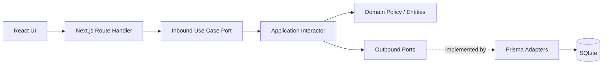

# Ports and Adapters

## Dependency rule

The domain and application core must not import framework or persistence libraries. Inbound adapters call application use cases. Outbound adapters implement interfaces declared by the application core.

## Inbound use cases

| Use case | Input | Output | Side effects |
|---|---|---|---|
| `GetFeedUseCase` | None from browser | Public profile DTO list | Read only |
| `RecordSwipeUseCase` | Profile ID, direction | Swipe result, optional mutual match DTO | Directed Swipe; optional Match |
| `GetMatchesUseCase` | None from browser | Mutual match DTO list | Read only |

The demo user is not an input field. It is resolved through the server-side `CurrentUserPort`.

## Outbound ports

### `CurrentUserPort`

Provides the configured demo user ID. The HTTP/browser caller cannot choose the actor identity.

### `ProfileRepositoryPort`

- `listEligibleForViewer(viewerUserId)` returns active profiles excluding targets with a Swipe authored by that viewer. Incoming decisions must not affect feed eligibility.
- `findActiveById(profileId)` resolves a swipe target.
- `findByOwnerUserId(ownerUserId)` resolves a match participant profile.

### `SwipeRepositoryPort`

- `findDecision(actorUserId, targetUserId)` resolves one directed decision.
- `createIfAbsent(decision)` must be atomic with respect to the unique actor/target pair. On a concurrent insert, it returns the stored decision so the use case can distinguish an identical retry from an opposite-direction conflict.

### `MatchRepositoryPort`

- `findBetween(first, second)` resolves an order-independent participant pair.
- `createIfAbsent(match)` enforces a unique canonical pair and returns whether a row was created.
- `listForUser(userId)` returns only match rows involving the requested user.

### `UnitOfWorkPort`

Executes a callback with transaction-scoped profile, swipe, and match repositories. The callback either commits all changes or rolls them all back. Match creation must not be performed outside this boundary.

## Composition root

`createDiscoveryApplication` receives all adapters and constructs the use cases. This is the only location in the core where the use cases are wired together. The future Next.js layer will construct the Prisma adapters and provide them to this root.

## HTTP adapter responsibilities

Route handlers will:

1. Parse JSON and validate untrusted request data.
2. Invoke one application use case.
3. Map application errors to stable HTTP status/error codes.
4. Serialize application DTOs only.

They will not query Prisma directly, decide a match, or expose internal entity objects.

## Frontend responsibilities

Components emit intent (`LIKE` or `PASS`) and render server-confirmed results. Buttons and drag gestures use the same swipe controller. A card exits permanently only after the server confirms the decision. A request failure restores the card and leaves the backend as the source of truth.
